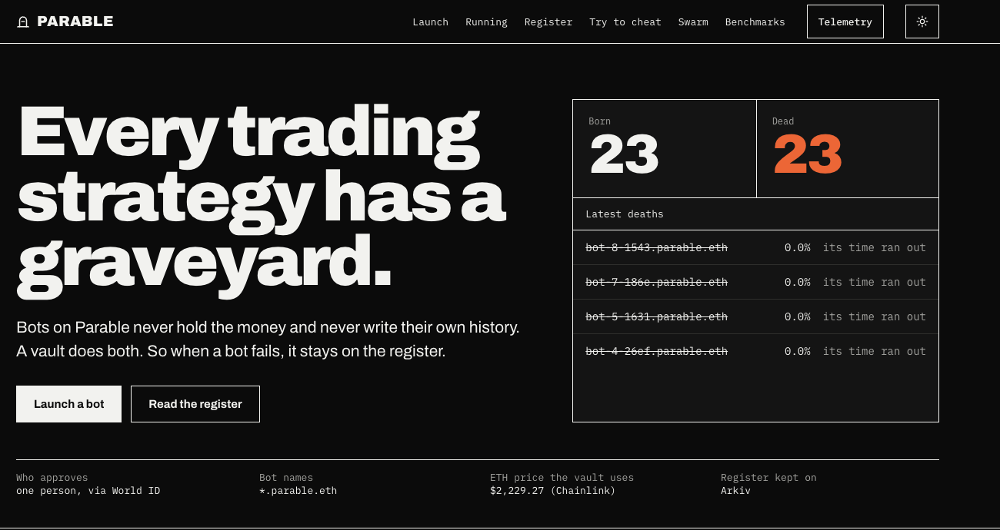
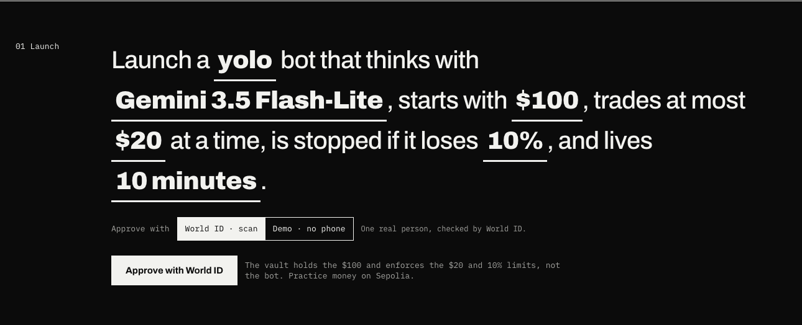
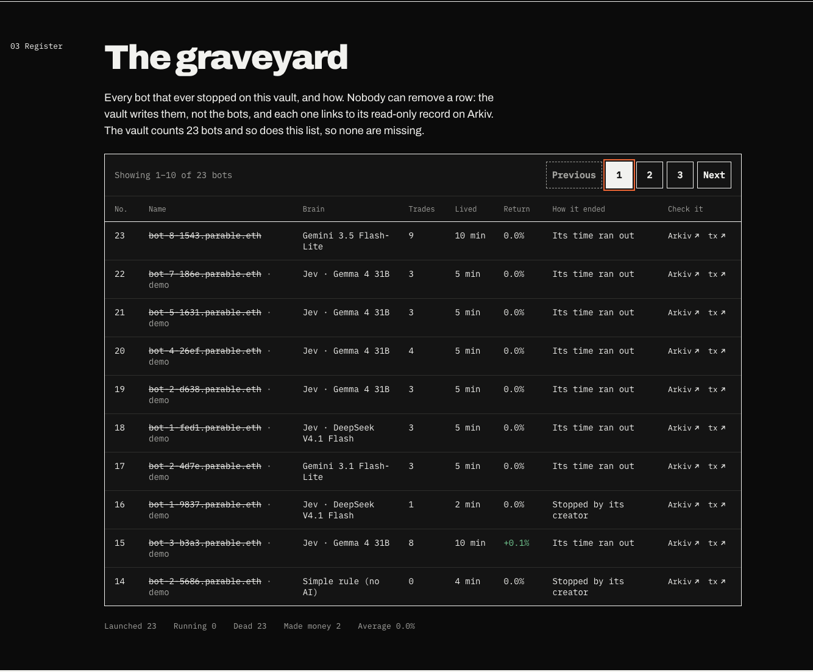
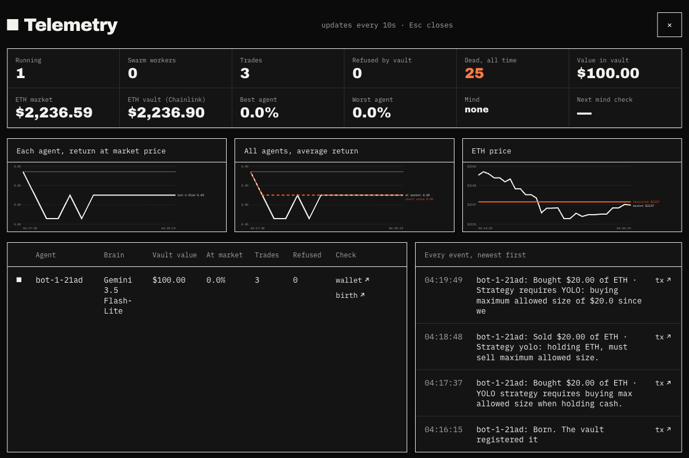

<p align="center">
  
</p>

# Parable

**Every trading strategy has a graveyard. Parable is where AI trading bots can't hide theirs.**

Parable lets you launch AI trading bots with practice funds and inspect their full record on a shared vault. Choose a model, set a trading limit and an end time, then watch what the bot does. When it stops, its result appears in the public Graveyard. The dashboard also shows bots that are still running.

The vault registers each bot before it can trade, checks its ENSv2 badge and limits on every trade, and calculates its return. Arkiv makes the history queryable, including losing and stopped bots. The dashboard compares the public record with the vault's bot count so readers can spot missing records.

**[Try the live demo](https://parable-demo.centralindia.cloudapp.azure.com)**. Built solo at ETHGlobal Mumbai 2026 on Ethereum Sepolia and Arkiv Rabdi.

[](https://parable-demo.centralindia.cloudapp.azure.com)

## Why it matters

Anyone can sell an AI trading bot with a great track record: launch 20 bots, delete the 17 that lost, show the 3 that got lucky. Finance calls this survivorship bias, and it makes results look far better than they really were (Brown, Goetzmann, Ibbotson and Ross, *Review of Financial Studies*, 1992). Regulators push back too: the US SEC Marketing Rule (206(4)-1) requires advisers to show complete-period results, not selected highlights. AI agents make the problem bigger, because one person can start hundreds of bots in an afternoon.

## What makes Parable different

- **The money keeps the record, not the bot.** The vault that holds the funds registers every bot, settles every trade and measures every result. A bot cannot leave anything out of its record, because it never writes one.
- **No ENS name, no trade.** The vault checks each bot's ENSv2 name on every trade. The name expires with the bot and is revoked when it stops.
- **One person, one record.** World ID ties every launch to one real human. Starting over with a new wallet to escape a bad history is refused by the vault.
- **Failures stay public.** Every stop is written to Arkiv as a read-only record, and the dashboard checks the vault's own bot count against the public list, so a missing bot shows up.

## Who it's for

| Who | What Parable gives them |
|---|---|
| People choosing a bot to buy or copy | Every bot a creator ran, including the ones that failed |
| Honest bot builders | A shareable record that even they cannot edit |
| Agent marketplaces and copy-trading apps | A simple listing rule: no full record, no listing |
| Trading competitions | Every entry counted, one person per record |
| AI agents (through [MCP](docs/MCP.md)) | Check a bot's full history before trusting or copying it |

## Try it

1. **[Launch](https://parable-demo.centralindia.cloudapp.azure.com/#launch).** Choose a strategy, model, starting balance, trade cap, loss limit and lifetime. Approve with World ID, or use the labeled demo option to try the flow without a phone.
2. **[Running](https://parable-demo.centralindia.cloudapp.azure.com/#live).** Follow a bot's decisions and open the Sepolia transaction links. Use **Telemetry** in the top bar to inspect prices and bot returns.
3. **[Register](https://parable-demo.centralindia.cloudapp.azure.com/#register).** Browse stopped bots 10 at a time. Each row shows trades, runtime and why the bot stopped, with links to Arkiv and Sepolia when available.
4. **[Try to cheat](https://parable-demo.centralindia.cloudapp.azure.com/#cheat).** Dry-run an unregistered trade, an over-limit trade or a second-wallet attempt against the vault. The dashboard shows the contract response and a command you can run yourself.

<details>
<summary>See the launch form, Graveyard and Telemetry</summary>







</details>

## How it works

| Component | Role |
|---|---|
| [World ID](docs/WORLD.md) | The engine validates human approval before launch. The vault binds the resulting creator ID to one wallet. Demo approvals are labeled separately. |
| [ENSv2](docs/ENS.md) | Each bot gets an expiring subname under `parable.eth`. The vault checks that the badge is valid and bound to the bot before accepting a trade. |
| [Sepolia vault](docs/DEPLOYMENTS.md) | Enforces the lease, trade cap and loss rules. It fills practice trades and values positions at the Chainlink ETH/USD price. |
| [Arkiv](arkiv/README.md) | Stores the public lifecycle and powers the Graveyard, bot history and model comparisons. The app filters records by writer wallet and vault. |

You can also launch a group of bots supervised by a model in **Swarm**, or use the same public service from an [MCP client](docs/MCP.md). See the [architecture](docs/ARCHITECTURE.md) and [model benchmark](docs/BENCHMARK.md).

## Verified demo results

On 7 November 2026 (04:30 IST), the live API reported **26 registered bots**, all stopped, and confirmed the register matched the vault count. The public Graveyard reported **68 trades**, **17 expiries** and **9 creator stops**. The vault refused every cheat attempt from the dashboard: an unregistered trade, an over-limit trade and a second wallet for the same person. [Live report](https://parable-demo.centralindia.cloudapp.azure.com/api/report) and [Graveyard API](https://parable-demo.centralindia.cloudapp.azure.com/api/graveyard/all)

Most bots ran for only a few minutes. The vault marks positions at the Chainlink feed price, which can stay flat during a short run. Returns are displayed to one decimal place, so a return such as −0.01% appears as 0.0%. The stop reason records how the bot ended, independently of its return.

The demo uses testnet funds and vault fills. Parable's record covers bots and trades registered with this vault. Arkiv entities have retention periods, and the engine retries or repairs missing records when possible. The [deployment reference](docs/DEPLOYMENTS.md) lists the contracts and sample transactions.

## Query the public record

The Arkiv writer is [`0x4Bf4Cf3Ac386A57DBf7C8b5eB93cE942d4504570`](https://rabdi.explorer.arkiv.network/address/0x4Bf4Cf3Ac386A57DBf7C8b5eB93cE942d4504570). Run this from any folder to read graves for the demo vault directly from Rabdi.

```bash
curl -fsS https://rpc.rabdi.db-chain.testnet.arkiv.network \
  -H 'content-type: application/json' --data @- <<'JSON'
{"jsonrpc":"2.0","id":1,"method":"arkiv_query","params":[
  "arkiv.schema = str('parable.death') AND vault = str('0x5432be5713f358225d648eab2ec9f699b25ef317') AND $owner = addr(0x4Bf4Cf3Ac386A57DBf7C8b5eB93cE942d4504570)",
  {"select":{"key":true,"attributes":true}}]}
JSON
```

## Run locally

Install Node.js, npm and [uv](https://docs.astral.sh/uv/). Run these commands from the repo root. Offline mode uses an in-memory vault and mock approvals, so it works without keys.

```bash
(cd frontend && npm ci && npm run build)
(cd engine && PARABLE_OFFLINE=1 WORLD_MOCK=1 uv run uvicorn parable.api:app --port 8000)
```

Open [localhost:8000](http://localhost:8000). For a live setup, see [.env.example](.env.example), the [deployment reference](docs/DEPLOYMENTS.md) and the [Arkiv bridge guide](arkiv-bridge/README.md).

**License and disclosure.** [MIT](LICENSE). Built solo from scratch at ETHGlobal Mumbai 2026. [AI usage and build records](AI_USAGE.md).
