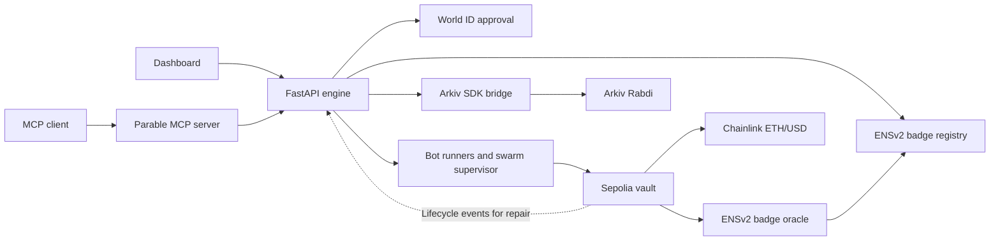

# Architecture

1. The engine validates a World ID approval for the pending launch, creates a bot wallet, issues an ENSv2 badge and registers the bot in the vault. The demo approval path creates a labeled demo record.
2. The runner asks its configured model or rule for a decision. The vault checks the bot, its badge, its lease, the trade cap and the price feed before accepting the order. It values the bot's position and applies the loss limit.
3. The engine writes lifecycle records through the Arkiv SDK bridge. It retries failed writes and checks the vault for missing bot and death records. Arkiv serves the public history, while the vault supplies the independent count and transaction evidence.

## Trust and scope

- The engine controls bot signing keys and verifies World ID. The vault enforces the creator-to-wallet binding from the verified registration. The contract can enforce a loss limit or lease expiry independently of the runner.
- The vault keeps each bot's practice balance and executes at the Chainlink price. It does not place exchange orders. The Practice Arena uses separate simulated balances and prices.
- Arkiv reads are scoped by writer and vault. Events and graves are read-only after writing and have finite retention. A count match checks completeness at the bot level. It does not verify every event.
- Bot keys and live charts are held in memory. A server restart stops existing runners. The repair process can record the bots' eventual expiry from the vault.

[Vault contract](../contracts/src/ParableVault.sol)  /  [Launch flow](../engine/parable/launcher.py)  /  [Arkiv repair](../engine/parable/repair.py)
